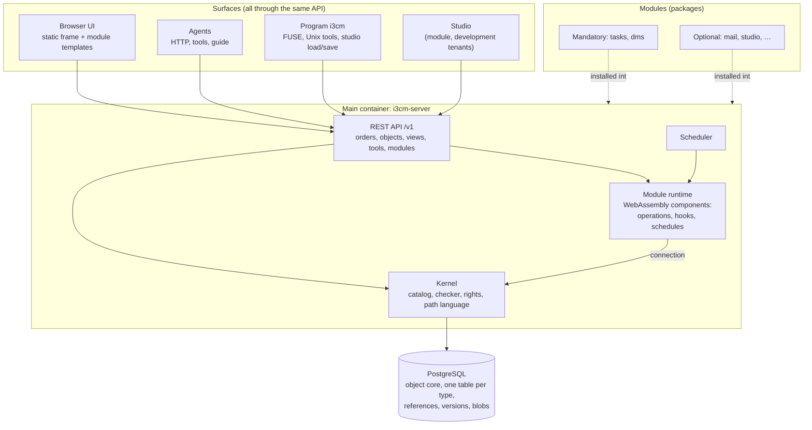

# Architecture

i3cm is a base for function portals: business data that stays reliable, opened to agents that stay
flexible. This page explains how the parts fit together; the details are in the developer, operator and
tenant administrator guides.

## Kernel, mandatory modules, modules

* The **kernel** (`i3cm-base`) knows no business: objects, types, rooms, profiles, the path language,
  views, the file system view, the tools, the API, the UI frame, the WebAssembly runtime and the scheduler.
  Its own types are parties, accounts, groups and rooms (namespace `base:`).
* **Mandatory modules** are delivered with the kernel and active in every tenant: `tasks` (tasks and
  deadlines) and `dms` (documents). Other modules may depend on them.
* **Modules** are repositories of their own (`i3cm-org/i3cm-<name>`): types, views, profiles, rooms,
  display texts, UI templates and optional code. They are packaged and signed, installed per instance by
  the operator and activated per tenant by the tenant administrator. A module is blind to tenants; the
  kernel separates them.

## One API, many surfaces

Every action exists once, as an operation of the API. The browser UI is a static frame that fills
templates with API data; the program `i3cm` turns Unix tools and a FUSE mount into API calls; agents use
HTTP directly or the tools over HTTP (`/v1/tools/exec`). No surface checks anything on its own: rights,
required attributes and rules are checked in the server, and a test keeps the API handlers on the store.

## Requests and transactions

A write is an **order**: a list of operations executed in one database transaction, all or nothing.
Module code runs inside it: an operation, the hooks around each operation and the calls between modules
share the transaction; writes go in at once, any error or trap aborts the whole order, and every order has
a deadline. Follow-up work runs after the commit. Mass work runs as one order per case, so that each
failure is visible on its own.

## Rights

Rights are given by **profiles** (collections of rights) assigned to groups and accounts, on rooms, with
signs `+`, `-` and `block`, inherited down the room tree. A right may carry a **rights path** that ties it
to the data (`applicant.team.leader = %me`). Lists combine rooms and rights paths as branches of one
`UNION` and page by key, so every page costs the same. What a caller may not read does not exist for them.

## Storage

PostgreSQL holds an object core table (id, tenant, room, versions, deletion) and one table per type with
only that type's own attributes; an object carrying several types has a row in each. References live in
relation tables, searchable in both directions. Every change writes a new version of the changed parts
only. Binary contents are stored once by hash; texts are indexed with trigrams for `grep`.

## Module runtime

Module code is a WebAssembly component (wasmtime, component model) built against the WIT world
`i3cm:module` (`wit/module.wit`). The kernel hands it an unforgeable `connection` resource with `me`,
`get`, `query`, `order`, `call` and `impersonate`; `impersonate` returns a new connection in the identity
of one of the module's own carriers and only for operations marked for it. Every transaction records the
caller, module, function, identity and tool. Schedules run per tenant, exactly once per period even with
several main containers.
